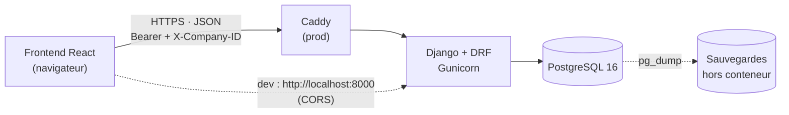

# WANS TECH — WANS COMMERCE

Plateforme SaaS de gestion commerciale pour les PME : catalogue, stocks, entrepôts, clients, ventes, paiements, rapports et tableau de bord, avec un espace isolé par entreprise cliente.

Ce README est le manuel principal du projet. Les documents de `docs/` approfondissent chaque sujet :

| Document | Contenu |
|---|---|
| [docs/AUDIT_FRONTEND.md](docs/AUDIT_FRONTEND.md) | Audit du frontend avant l'ajout du backend |
| [docs/API_CONTRACT.md](docs/API_CONTRACT.md) | Contrat d'API et correspondance écrans ↔ endpoints |
| [docs/ARCHITECTURE.md](docs/ARCHITECTURE.md) | Monolithe modulaire, multi-entreprise, modèle de données, évolution |
| [docs/SECURITY.md](docs/SECURITY.md) | Authentification, autorisations, protections, limites |
| [docs/DEPLOYMENT.md](docs/DEPLOYMENT.md) | Production, sauvegardes, restauration |
| [docs/TESTING.md](docs/TESTING.md) | Organisation des tests et résultats observés |
| [docs/FRONTEND.md](docs/FRONTEND.md) | Détails du frontend (design, mode démonstration, adaptations) |
| [docs/REORGANIZATION_PLAN.md](docs/REORGANIZATION_PLAN.md) / [REORGANIZATION_REPORT.md](docs/REORGANIZATION_REPORT.md) | Séparation physique `frontend/` / `backend/` : plan et rapport |

Le dépôt est un **monorepo** : deux applications indépendantes, `frontend/` (React + Vite) et `backend/` (Django), chacune avec ses dépendances, sa configuration, son Dockerfile et ses tests, orchestrées depuis la racine par Docker Compose.

---

## A. Présentation

**Objectif.** Donner aux PME (commerce de gros, distribution, détail, en premier lieu en RDC) un outil unique pour suivre leur catalogue et leurs stocks, enregistrer ventes et encaissements, et piloter l'activité à partir de chiffres fiables.

**Public cible.** Dirigeants, gestionnaires et vendeurs de PME ; opérateurs WANS TECH qui exploitent la plateforme.

**Fonctionnalités réellement implémentées (backend + frontend en mode API).**

- Comptes : inscription (création d'un compte et de son entreprise), connexion, session renouvelée par cookie sécurisé, déconnexion, profil, changement de mot de passe.
- Multi-entreprise : un utilisateur peut appartenir à plusieurs entreprises, avec un rôle par entreprise ; sélection de l'entreprise active ; ajout, changement de rôle, suspension et réactivation des collaborateurs ; désactivation d'une entreprise par l'administration.
- Catalogue : produits, catégories, fournisseurs.
- Stocks : stock initial, mouvements tracés, alertes sous le minimum, réapprovisionnements (planification, réception, annulation), entrepôts.
- Clients : création, consultation, totaux d'achats calculés.
- Ventes : brouillon, vente confirmée, transaction réglée immédiatement ; totaux recalculés par le serveur ; stock décrémenté de façon atomique et concurrente ; idempotence ; confirmation, changement de statut et annulation avec restitution du stock (API).
- Paiements : rapprochement avec une commande, paiements partiels, contrôle du reste à payer et des références en double.
- Pilotage : tableau de bord (chiffre d'affaires, transactions, commandes, stock), courbes, indicateurs des pages, analyses mensuelles, marges par catégorie, rapports (ventes, stocks, financier, clients, produits, paiements) exportés en PDF/Excel/CSV, recherche globale, notifications de stock.
- Journal d'audit, documentation OpenAPI/Swagger, Docker (développement et production), sauvegarde et restauration de contrôle.

**Prévu mais non terminé.** Prévisions par modèle statistique, détection d'anomalies, recommandations, assistant IA, radar de performance, facturation de l'abonnement, téléversement d'images, invitations et réinitialisation de mot de passe par e-mail, dépenses, stock par entrepôt pour un même produit, Row-Level Security PostgreSQL.

**État réel.** Le backend est implémenté et testé (106 tests sur PostgreSQL 16, localement et dans Docker). Le frontend est branché sur l'API pour tous les écrans de gestion ; il compile et ses tests passent, et un parcours d'intégration HTTP complet a été vérifié contre le backend Docker. **Le rendu du mode API n'a pas été vérifié visuellement dans un navigateur** (pas de navigateur piloté disponible pendant la livraison) : c'est la première vérification à faire (section L). Le mode démonstration est conservé à l'identique.

## B. Technologies

| Couche | Technologie | Version | Rôle |
|---|---|---|---|
| Frontend | React | 19 | Interface |
| | TypeScript | 5.7 (strict) | Typage, types partagés avec le contrat d'API |
| | Vite | 7 | Développement et build |
| | React Router | 7 | Routage, pages chargées à la demande |
| | Recharts | 3 | Graphiques |
| | Vitest + Testing Library | 3.2 / 16 | Tests frontend |
| Backend | Python | **3.13** | Langage (image `python:3.13-slim`) |
| | Django | 5.2.18 **LTS** | Framework, ORM, administration (correctifs jusqu'en avril 2028) |
| | Django REST Framework | 3.18.3 | API REST |
| | Simple JWT | 5.5.1 | Jetons d'accès et de rafraîchissement, liste noire |
| | django-cors-headers | 4.9.0 | CORS en liste blanche |
| | drf-spectacular | 0.30.0 | Schéma OpenAPI 3 et Swagger UI |
| | psycopg | 3.3.6 | Pilote PostgreSQL |
| | Gunicorn | 26.2.0 | Serveur applicatif de production |
| | pytest + pytest-django | 9.1.1 / 4.14.0 | Tests backend |
| Données | PostgreSQL | 16 | Base unique partagée par les entreprises |
| Exploitation | Docker / Docker Compose | Compose v2 | Environnements de développement et de production |
| | Caddy | 2.10 | Reverse proxy de production, HTTPS automatique |

Toutes les versions Python sont verrouillées, y compris les dépendances transitives (`backend/requirements.txt`). Django 6.1 existe, mais la LTS 5.2 a été retenue pour sa durée de support et sa compatibilité éprouvée avec DRF, Simple JWT et drf-spectacular.

## C. Architecture globale



**Monolithe modulaire.** Une seule application Django, découpée en applications par domaine (`backend/apps/`) : `core`, `accounts`, `companies`, `audit`, `warehouses`, `catalog`, `inventory`, `customers`, `sales`, `payments`, `reports`. Chaque domaine possède ses modèles, ses services, ses vues et ses routes ; les dépendances entre modèles ne forment aucun cycle.

**DDD et hexagonal, dans ce qui est utile.** Les vues HTTP valident l'entrée puis délèguent aux **services** métier (`services.py`), qui portent les règles (stock jamais négatif, totaux recalculés, transitions, reste à payer). Les lectures agrégées passent par des **sélecteurs** (`selectors.py`). Les invariants sont doublés par des contraintes PostgreSQL. Il n'y a volontairement pas de couche « repository » devant l'ORM. Détails : [ARCHITECTURE.md](docs/ARCHITECTURE.md) §3.

**Flux d'une requête.** Composant React → `frontend/src/services/index.ts` → `apiAdapters.ts` → `http.ts` (jeton, entreprise, cookie, nouvel essai après 401) → Caddy → Gunicorn → DRF (`JWTAuthentication`) → permission `CompanyAccess` (adhésion active + capacité du rôle) → serializer → service métier (transaction, verrous) → PostgreSQL → audit → réponse JSON au format des types TypeScript. Exemple détaillé : [ARCHITECTURE.md](docs/ARCHITECTURE.md) §4.

## D. Structure des fichiers

```
.
├── frontend/                    Application React + Vite (voir docs/FRONTEND.md)
│   ├── src/
│   │   ├── services/            index.ts (point d'entrée), apiAdapters.ts, http.ts, session.ts, demo/
│   │   └── pages/  layout/  components/  hooks/  lib/  types/  test/  theme/  styles/  app/
│   ├── public/                  favicon et fichiers statiques
│   ├── index.html  package.json  package-lock.json  tsconfig.json  vite.config.ts
│   ├── Dockerfile               cible « dev » (serveur Vite) ; cible finale : build + Caddy (production)
│   ├── Caddyfile                reverse proxy de production (HTTPS, CSP, relais /api et /admin)
│   ├── .dockerignore
│   └── .env.example             variables VITE_* (copier en frontend/.env)
├── backend/                     Application Django
│   ├── config/                  settings.py (variables d'environnement), settings_test.py, urls.py, wsgi.py
│   ├── apps/
│   │   ├── core/                TenantModel, montants, format d'erreur, pagination, santé
│   │   ├── accounts/            User, authentification JWT, cookie de rafraîchissement
│   │   ├── companies/           Company, Membership, rôles, tenancy.py (isolation), numérotation
│   │   ├── audit/               AuditLog et service d'enregistrement
│   │   ├── warehouses/          Entrepôts
│   │   ├── catalog/             Catégories, fournisseurs, produits
│   │   ├── inventory/           Mouvements, réapprovisionnements, alertes, notifications
│   │   ├── customers/           Clients
│   │   ├── sales/               Commandes, lignes, sélecteurs de ventes
│   │   ├── payments/            Paiements
│   │   └── reports/             Tableau de bord, statistiques, analyses, rapports, recherche
│   ├── tests/                   Tests pytest (PostgreSQL)
│   ├── docker/                  entrypoint.sh, gunicorn.conf.py
│   ├── Dockerfile  .dockerignore  requirements.txt  requirements-dev.txt  pytest.ini  manage.py
├── scripts/                     backup.sh, verify-backup.sh, restore.sh (PostgreSQL)
├── backups/                     sauvegardes .dump (ignoré par Git)
├── docs/                        Documentation technique
├── docker-compose.yml           Développement (db + backend + frontend)
├── docker-compose.prod.yml      Production (db + backend + web)
├── .env.example                 Variables de Docker Compose, Django et PostgreSQL (copier en .env)
└── .env.production.example      Variables de production
```

Dans chaque application Django : `models.py` (entités et contraintes), `serializers.py` (validation et format camelCase), `views.py` (HTTP), `services.py` (règles et écritures), `selectors.py` (lectures agrégées, si utile), `urls.py`, `admin.py`, `migrations/`. Les permissions et l'isolation sont centralisées dans `apps/companies/roles.py` et `apps/companies/tenancy.py`. Les tests sont regroupés par thème dans `backend/tests/`.

## E. Architecture SaaS multi-entreprise

- **Instance partagée.** Un code, une application Django, une base PostgreSQL pour toutes les entreprises. Les données sont séparées **logiquement** : chaque ligne métier porte sa clé `company`.
- **Entreprises et adhésions.** `Company` (UUID, profil, `is_active`) et `Membership` (utilisateur, entreprise, rôle, état actif/suspendu). L'inscription crée un compte, une entreprise et l'adhésion propriétaire dans une même transaction ; elle ne permet jamais de rejoindre une entreprise existante ni de choisir un rôle.
- **Entreprise active.** Le frontend envoie `X-Company-ID` à chaque requête (mémorisé localement, changeable depuis le menu du profil). Le serveur ne lui fait pas confiance : il revérifie l'adhésion à **chaque** requête.
- **Rôles.** Propriétaire, administrateur, gestionnaire, vendeur, lecteur ; capacités détaillées dans [API_CONTRACT.md](docs/API_CONTRACT.md) §2. Un membre n'attribue qu'un rôle inférieur au sien.
- **Isolation.** QuerySets filtrés par l'entreprise active, références entrantes résolues dans l'entreprise active (un SKU d'une autre PME est « introuvable »), entreprise propriétaire affectée par le serveur, agrégats et exports filtrés, unicités par entreprise en base. Un objet d'une autre entreprise répond 404.
- **Vérifié par des tests** : lecture, modification, suppression, accès par l'URL, vente avec un produit étranger, paiements, clients, stocks, statistiques, exports, recherche, notifications, non-membre, suspension, entreprise désactivée, membre de deux entreprises, accès anonyme et jeton falsifié (`backend/tests/test_isolation.py`, 28 cas, tous réussis).
- **Limites.** Pas de Row-Level Security PostgreSQL (évaluée, reportée : voir [ARCHITECTURE.md](docs/ARCHITECTURE.md) §5) ; la sécurité repose sur la discipline du code applicatif, couverte par les tests. Toute nouvelle vue doit hériter de `CompanyScopedViewSet` ou `CompanyScopedMixin`.
- **Pourquoi pas une copie par PME ?** Une copie par client multiplie les mises à jour, les migrations, les coûts et les risques de divergence, sans gain de sécurité tant que l'isolation logique est correcte et testée. Le nombre de conteneurs dépend des services, pas des clients.
- **Base séparée** : envisageable pour une exigence contractuelle ou réglementaire, un client très volumineux, un besoin de restauration individuelle ou de schéma spécifique ([ARCHITECTURE.md](docs/ARCHITECTURE.md) §7).

## F. Modèle de données

Entités principales : `User`, `Company`, `Membership`, `CodeSequence`, `Warehouse`, `Category`, `Supplier`, `Product`, `StockMovement`, `Restock`, `Customer`, `Order`, `OrderLine`, `Payment`, `Report`, `AuditLog`. Diagramme et règles : [ARCHITECTURE.md](docs/ARCHITECTURE.md) §6.

- **Propriété des données** : tout modèle métier hérite de `TenantModel` (`company`, `PROTECT`) ; les codes publics (`CMD-00001`, `CLI-0001`, `ENT-001`, `PAI-00001`, `REA-0001`, `RAP-001`) sont uniques par entreprise.
- **Montants** : `NUMERIC(14,2)` en CDF, calculs en `Decimal`, arrondi au centime demi supérieur ; renvoyés en nombres JSON.
- **Contraintes clés** : stock ≥ 0 ; prix > 0 ; quantité > 0 ; remise entre 0 et 100 % ; `total = sous-total − remise` ; une ligne par produit et par commande ; référence de paiement unique par entreprise (insensible à la casse) ; e-mail client unique par entreprise ; un seul propriétaire par entreprise ; clé d'idempotence unique par entreprise.
- **Statuts** : commande `Brouillon` → `En traitement` ↔ `En attente`, `En traitement` → `Expédiée` → `Livrée`, annulation possible avant livraison et sans paiement réglé ; paiement `Réglé`, `En attente`, `En traitement`, `Échoué` ; réapprovisionnement `planned`, `received`, `cancelled`.
- **Traçabilité** : commandes et paiements jamais supprimés ; mouvements de stock immuables avec solde après mouvement ; journal d'audit.
- **Dates** : dates métier en `YYYY-MM-DD`, horodatages UTC, fuseau de calcul `Africa/Kinshasa`.

## G. Contrat API

- Préfixe : `/api/v1/` ; JSON camelCase identique aux types de `frontend/src/types/domain.ts`.
- Authentification : `Authorization: Bearer <jeton d'accès>` ; cookie HttpOnly `wans_refresh` pour `/auth/refresh/` et `/auth/logout/` (avec `X-Requested-With: XMLHttpRequest`).
- Entreprise : `X-Company-ID: <uuid>` sur tous les endpoints métier.
- Erreurs : `{"detail": "...", "code": "...", "fields": {...}}` ; 400 validation, 401 non authentifié, 403 accès refusé, 404 introuvable (y compris autre entreprise), 409 conflit métier, 429 trop de requêtes.
- Pagination : `?page=&pageSize=` (100 par défaut, 500 au plus) → `{count, next, previous, results}`.

| Domaine | Endpoints principaux |
|---|---|
| Authentification | `POST /auth/register/`, `/auth/login/`, `/auth/refresh/`, `/auth/logout/`, `GET/PATCH /auth/me/`, `POST /auth/change-password/` |
| Entreprise | `GET/PATCH /company/`, `GET/POST /company/members/`, `PATCH /company/members/{id}/` |
| Catalogue | `GET/POST /products/`, `GET/PATCH/DELETE /products/{sku}/`, `GET/POST /categories/`, `GET/POST /suppliers/` |
| Stocks | `GET/POST /warehouses/`, `PATCH /warehouses/{code}/`, `GET /inventory/`, `/inventory/alerts/`, `/inventory/movements/`, `GET/POST /restocks/`, `POST /restocks/{code}/receive/`, `/cancel/` |
| Clients | `GET/POST /customers/`, `GET/PATCH /customers/{code}/` |
| Ventes | `GET/POST /orders/`, `GET /orders/{code}/`, `POST /orders/{code}/confirm/`, `/status/`, `/cancel/` |
| Paiements | `GET/POST /payments/` |
| Pilotage | `GET /dashboard/summary/`, `/dashboard/revenue/`, `/stats/{sales,customers,inventory,payments}/`, `/analytics/monthly/`, `/analytics/margins/` |
| Rapports | `GET/POST /reports/`, `GET /reports/rows/`, `GET /reports/{code}/rows/` |
| Divers | `GET /search/`, `/notifications/`, `/health/`, `/schema/`, `/docs/` |

Correspondance détaillée écrans ↔ endpoints, formats et règles : [docs/API_CONTRACT.md](docs/API_CONTRACT.md). Schéma exact : `GET /api/v1/schema/` ou Swagger `http://localhost:8000/api/v1/docs/` en développement.

## H. Installation locale

**Prérequis** : Node.js 20+ (testé avec 24.13), npm ; Docker Desktop (ou Docker Engine) avec Compose ; Python 3.13 si le backend est lancé hors Docker.

Deux fichiers d'environnement, un par usage :

| Fichier | Lu par | Contenu |
|---|---|---|
| `.env` (racine, modèle `.env.example`) | Docker Compose, Django | PostgreSQL, Django, CORS |
| `frontend/.env` (modèle `frontend/.env.example`) | Vite (`npm run dev`, `npm run build`) | `VITE_*` uniquement (publiques) |

```bash
git clone <dépôt> wans-tech && cd wans-tech
cp .env.example .env                       # éditer POSTGRES_PASSWORD (valeur locale quelconque)
cp frontend/.env.example frontend/.env     # VITE_DATA_SOURCE=api pour utiliser le backend
```

**Option 1 — tout dans Docker (recommandée).**

```bash
docker compose up -d --build        # PostgreSQL + backend + frontend ; migrations appliquées au démarrage
docker compose exec backend python manage.py createsuperuser
```

Dans Docker, le frontend est toujours en mode API (`VITE_DATA_SOURCE=api`, défini dans `docker-compose.yml`).

**Option 2 — backend dans Docker, frontend sur la machine** (pratique pour le développement de l'interface) :

```bash
docker compose up -d db backend
cd frontend
npm install
npm run dev
```

**Option 3 — sans Docker pour les applications** (PostgreSQL via Docker ou installé localement) :

```bash
docker compose up -d db                                  # ou un PostgreSQL 16 local
# Backend (depuis la racine)
python -m venv backend/.venv
backend/.venv/Scripts/python -m pip install -r backend/requirements-dev.txt   # Linux/macOS : backend/.venv/bin/python
set -a && . ./.env && set +a                             # charge le .env racine dans le shell (bash)
cd backend
.venv/Scripts/python manage.py migrate
.venv/Scripts/python manage.py createsuperuser
.venv/Scripts/python manage.py runserver                 # http://localhost:8000
# Frontend (autre terminal)
cd frontend && npm install && npm run dev                # http://localhost:5173
```

Sous Windows, gardez `POSTGRES_HOST=127.0.0.1` : `localhost` peut se résoudre en IPv6 et rester bloqué.

**Adresses locales**

| Service | Adresse |
|---|---|
| Frontend | http://localhost:5173 |
| API | http://localhost:8000/api/v1/ |
| Santé | http://localhost:8000/api/v1/health/ |
| Swagger | http://localhost:8000/api/v1/docs/ |
| Administration | http://localhost:8000/admin/ |
| PostgreSQL | 127.0.0.1:5432 (port local uniquement) |

Toutes ces adresses ont été vérifiées le 17/10/2026 avec la pile Docker de développement (Swagger est public en développement car `API_DOCS_PUBLIC` vaut `DEBUG` par défaut).

**Vérifier le fonctionnement** : la santé renvoie `{"status": "ok", "database": "ok"}` ; avec `VITE_DATA_SOURCE=api`, le frontend ouvre `/connexion` ; « Créer un espace » crée votre entreprise ; créez un entrepôt, un produit, un client puis une vente, et vérifiez que le stock et le tableau de bord évoluent. Après modification de `frontend/.env`, relancez `npm run dev` (Vite ne relit pas les variables à chaud).

## I. Lancement avec Docker

| Service (`docker-compose.yml`) | Rôle |
|---|---|
| `db` | PostgreSQL 16, volume persistant `wanstech_pgdata`, sonde `pg_isready`, port publié sur 127.0.0.1 seulement |
| `backend` | Django (serveur de développement avec rechargement), code monté depuis `./backend`, attend la base puis applique les migrations ; sonde sur `/api/v1/health/` |
| `frontend` | Serveur Vite (cible `dev` de `frontend/Dockerfile`), code monté depuis `./frontend`, rechargement à chaud ; démarre quand le backend est sain |

**Adresses : navigateur ou conteneur ?** Le navigateur appelle l'API par le port publié sur la machine (`http://localhost:8000`) : c'est la valeur de `VITE_API_BASE_URL`, jamais le nom de service `backend`. Entre conteneurs, on utilise le nom du service : Django joint PostgreSQL par `POSTGRES_HOST=db` (forcé par Compose), et Caddy joint Django par `backend:8000` en production. Les variables `VITE_*` sont figées dans le bundle **au build** ; les variables Django sont lues **à l'exécution**.

```bash
docker compose up -d --build                          # démarrer (db + backend + frontend)
docker compose up -d db backend                       # sans le frontend
docker compose ps                                     # état et sondes de santé
docker compose logs -f backend                        # journaux (ou frontend, db)
docker compose exec backend python manage.py migrate  # migrations
docker compose exec backend python manage.py createsuperuser
docker compose exec backend python -m pytest -q       # tests dans le conteneur
docker compose exec db psql -U wanstech -d wanstech   # console PostgreSQL
docker compose up -d --build -V frontend              # après une modification de package.json (recrée node_modules)
docker compose down                                   # arrêter (les données restent dans le volume)
```

**Persistance des données.** Les données PostgreSQL sont dans le volume nommé `wanstech_pgdata`. Son nom dépend du nom de projet fixé dans `docker-compose.yml` (`name: wanstech`), pas du dossier : déplacer ou renommer le dépôt ne le perd pas. `docker compose down` le conserve. Ne lancez jamais `docker compose down -v` sans intention explicite : `-v` supprime le volume de la base. Avant toute opération risquée : `scripts/backup.sh`.

**Diagnostic**

| Symptôme | Cause probable |
|---|---|
| `POSTGRES_PASSWORD manquant` | `.env` absent à la racine ou variable vide |
| Le backend redémarre en boucle | `docker compose logs backend` ; base injoignable ou erreur de migration |
| Le frontend affiche « Le serveur est injoignable » | Backend arrêté, ou `VITE_API_BASE_URL` incorrect (doit être l'adresse vue par le navigateur) |
| Le frontend reste en données de démonstration (`npm run dev`) | `frontend/.env` absent ou `VITE_DATA_SOURCE=demo` ; relancer `npm run dev` |
| Erreur CORS dans la console du navigateur | Origine absente de `CORS_ALLOWED_ORIGINS` (`http://localhost:5173` par défaut) |
| Port 5432, 5173 ou 8000 déjà utilisé | Changer `POSTGRES_HOST_PORT`, arrêter le service concurrent (ex. un `npm run dev` local quand le conteneur `frontend` tourne) |
| Les modifications du frontend ne sont pas prises en compte dans Docker | `docker compose logs frontend` ; la surveillance par scrutation (`CHOKIDAR_USEPOLLING`) est activée |
| `failed to connect to the docker API` | Docker Desktop n'est pas démarré |

Production : `docker-compose.prod.yml` et [docs/DEPLOYMENT.md](docs/DEPLOYMENT.md).

## J. Variables d'environnement

Le fichier `.env` (racine) sert à Docker Compose et à Django ; `frontend/.env` sert à Vite. Seules les variables `VITE_*` sont incluses dans le bundle du navigateur : elles ne doivent jamais contenir de secret (vérifié sur le build de production : aucune variable backend n'y figure). Aucun fichier `.env` n'est copié dans les images Docker (`.dockerignore`).

| Variable | Rôle | Obligatoire | Exemple non sensible | Environnement |
|---|---|---|---|---|
| `VITE_DATA_SOURCE` | `demo` ou `api` | Non (défaut `demo`) | `api` | Frontend (`frontend/.env`) |
| `VITE_API_BASE_URL` | URL du backend vue par le navigateur ; vide = même origine | Non | `http://localhost:8000` | Frontend (`frontend/.env`) |
| `VITE_API_PREFIX` | Préfixe de l'API | Non (défaut `/api/v1`) | `/api/v1` | Frontend (`frontend/.env`) |
| `DJANGO_DEBUG` | Mode débogage | Non (défaut `false`) | `true` | Dev uniquement |
| `DJANGO_SECRET_KEY` | Clé de signature Django et JWT | **Oui si DEBUG=false** | *(50 caractères aléatoires)* | Prod |
| `DJANGO_ALLOWED_HOSTS` | Hôtes acceptés | Oui en prod | `app.exemple.cd` | Tous |
| `CORS_ALLOWED_ORIGINS` | Origines autorisées (liste) | Non | `http://localhost:5173` | Dev (vide en prod) |
| `CSRF_TRUSTED_ORIGINS` | Origines de confiance pour l'administration | Oui en prod | `https://app.exemple.cd` | Prod |
| `REGISTRATION_OPEN` | Inscription publique | Non (défaut `true`) | `false` | Tous |
| `API_DOCS_PUBLIC` | Swagger public | Non (défaut = DEBUG) | `false` | Tous |
| `JWT_ACCESS_MINUTES` / `JWT_REFRESH_DAYS` | Durées des jetons | Non (10 / 7) | `10` / `7` | Tous |
| `JWT_SIGNING_KEY` | Clé JWT distincte | Non (défaut : clé Django) | — | Prod |
| `REFRESH_COOKIE_SECURE` / `_SAMESITE` / `_DOMAIN` | Cookie de rafraîchissement | Non (`Secure` si DEBUG=false, `Lax`) | `true` | Tous |
| `SECURE_SSL_REDIRECT` / `SECURE_HSTS_SECONDS` | HTTPS côté Django | Non (`false` / `0`) | `true` / `31536000` | Prod |
| `THROTTLE_ANON`, `THROTTLE_USER`, `THROTTLE_LOGIN`, `THROTTLE_REGISTER`, `THROTTLE_REFRESH` | Limitation de débit | Non | `10/min` | Tous |
| `DJANGO_LOG_LEVEL` | Niveau de journalisation | Non (`INFO`) | `INFO` | Tous |
| `DB_CONN_MAX_AGE` | Persistance des connexions (s) | Non (60) | `60` | Tous |
| `POSTGRES_DB`, `POSTGRES_USER` | Base et rôle | Non (`wanstech`) | `wanstech` | Tous |
| `POSTGRES_PASSWORD` | Mot de passe PostgreSQL | **Oui** | *(aléatoire)* | Tous |
| `POSTGRES_HOST`, `POSTGRES_PORT` | Hôte et port vus par Django | Non (`127.0.0.1`, `5432`) | `db` (forcé dans Docker) | Tous |
| `POSTGRES_HOST_PORT` | Port publié sur la machine | Non (`5432`) | `5433` | Dev |
| `RUN_MIGRATIONS`, `COLLECT_STATIC` | Actions au démarrage du conteneur | Non | `true` | Docker |
| `GUNICORN_WORKERS`, `GUNICORN_THREADS`, `GUNICORN_TIMEOUT`, `GUNICORN_FORWARDED_ALLOW_IPS` | Serveur applicatif | Non (3, 2, 60, `127.0.0.1`) | `3` | Prod |
| `APP_DOMAIN` | Domaine public (certificat HTTPS) | Oui en prod | `app.exemple.cd` | Prod |

## K. Authentification et sécurité

- **Cycle** : connexion → jeton d'accès (10 min, en mémoire) + cookie HttpOnly de rafraîchissement (7 jours, rotation, liste noire). Au rechargement, le frontend reprend la session par `/auth/refresh/` ; après un 401, il rafraîchit une fois puis rejoue la requête ; sinon il renvoie vers `/connexion`. La déconnexion et le changement de mot de passe révoquent les jetons.
- **Permissions** : capacités par rôle, écritures refusées par défaut, vérifiées à chaque requête.
- **Isolation** : section E.
- **CORS / CSRF** : liste blanche en développement, même origine en production ; en-tête `X-Requested-With` exigé pour le rafraîchissement et la déconnexion ; CSRF Django conservé pour l'administration.
- **Production** : HTTPS (Caddy), HSTS, cookies `Secure`, CSP stricte, documentation API réservée, `DEBUG=false` imposé, `manage.py check --deploy` sans alerte hormis le préchargement HSTS (choix délibéré).
- **Limites connues** : pas de RLS, pas de double authentification, pas de réinitialisation par e-mail, jeton d'accès volé valable 10 min au plus, limitation de débit par worker. Détails : [docs/SECURITY.md](docs/SECURITY.md).

## L. Tests et qualité

```bash
# Backend (PostgreSQL requis : docker compose up -d db, puis .env racine chargé)
cd backend && .venv/Scripts/python -m pytest -q          # Linux/macOS : .venv/bin/python
.venv/Scripts/python manage.py check
.venv/Scripts/python manage.py makemigrations --check --dry-run
docker compose exec backend python -m pytest -q          # ou dans le conteneur (depuis la racine)

# Frontend (depuis frontend/)
cd frontend
npm ci                 # installation reproductible depuis package-lock.json
npm run typecheck
npm test
npm run build
```

Le frontend n'a pas de linter configuré (pas d'ESLint ni de script `lint`).

| Contrôle | Résultat observé à la livraison |
|---|---|
| Tests backend (pytest, PostgreSQL 16) | **106 réussis**, sur la machine et dans le conteneur |
| Dont isolation multi-entreprise | 28 réussis |
| Dont concurrence (transactions réelles, threads) | 2 réussis |
| Tests frontend (Vitest) | **38 réussis** (dont 8 nouveaux sur le client HTTP et les adaptateurs), stables sur 3 exécutions après passage en exécution séquentielle |
| TypeScript (`tsc --noEmit`) | Aucune erreur |
| `manage.py check` / `makemigrations --check` | Aucun problème / aucune migration manquante |
| `manage.py check --deploy` (configuration de production) | 1 avertissement : `SECURE_HSTS_PRELOAD` (délibéré) |
| Schéma OpenAPI (`spectacular --validate`) | Valide, sans avertissement |
| Parcours d'intégration HTTP frontend → backend Docker | 22 vérifications réussies (CORS, cookie, vente, idempotence, paiement, tableau de bord, rafraîchissement, révocation) |
| Build frontend en mode API | Réussi ; aucun secret dans le bundle |
| Sauvegarde + restauration de contrôle | Réussies sur la base de développement |
| Image Docker du backend | Construite et testée |
| Pile de production locale (Caddy + Gunicorn + PostgreSQL, `APP_DOMAIN=localhost`) | Validée : HTTPS, en-têtes de sécurité, frontend, API, administration, documentation fermée, parcours de vente |

**Restent à exécuter** : vérification visuelle du mode API dans un navigateur réel (connexion, chaque page, formulaires, mobile) ; `scripts/restore.sh` (destructif, non lancé) ; production avec un vrai domaine et un certificat Let's Encrypt ; tests de charge ; audit de sécurité externe. Détails : [docs/TESTING.md](docs/TESTING.md).

## M. Déploiement en production

Résumé (procédure complète : [docs/DEPLOYMENT.md](docs/DEPLOYMENT.md)) :

1. Serveur Linux avec Docker, DNS du domaine vers le serveur, ports 80/443 ouverts.
2. `cp .env.production.example .env.production`, renseigner les secrets, `chmod 600`.
3. `docker compose -f docker-compose.prod.yml --env-file .env.production build`, puis migrations (`run --rm backend python manage.py migrate`), superutilisateur, `up -d`.
4. Caddy obtient le certificat HTTPS, sert le frontend et relaie `/api` et `/admin` ; les fichiers statiques sont collectés au démarrage.
5. Journaux : `docker compose -f docker-compose.prod.yml logs -f backend|web|db` ; sonde `/api/v1/health/`.
6. Sauvegardes quotidiennes (`scripts/backup.sh`), copiées et chiffrées hors serveur, restauration de contrôle mensuelle (`scripts/verify-backup.sh`).
7. Mise à jour : sauvegarde → `git checkout` → `build` → `migrate` → `up -d` ; retour arrière par la version précédente ou la sauvegarde.

**Déploiement séparé du frontend et du backend (variante).** Les deux applications sont indépendantes et peuvent être hébergées séparément :

- *Backend* : image construite depuis `backend/` (`docker build ./backend`), Gunicorn derrière un reverse proxy HTTPS, PostgreSQL managé ou dédié ; définir `DJANGO_ALLOWED_HOSTS` (ex. `api.exemple.cd`), `CORS_ALLOWED_ORIGINS` et `CSRF_TRUSTED_ORIGINS` avec l'origine exacte du frontend, `REFRESH_COOKIE_SECURE=true` ; si les domaines diffèrent, vérifier `REFRESH_COOKIE_SAMESITE`/`REFRESH_COOKIE_DOMAIN` (le cookie de rafraîchissement doit être envoyé par le navigateur).
- *Frontend* : `cd frontend && VITE_DATA_SOURCE=api VITE_API_BASE_URL=https://api.exemple.cd npm run build`, puis publier `frontend/dist/` sur tout hébergement statique avec repli des routes vers `index.html`, et reprendre les en-têtes de sécurité de `frontend/Caddyfile` en ajoutant le domaine de l'API à `connect-src`.
- La configuration fournie (même origine via Caddy) reste la plus simple : pas de CORS, cookie limité à un domaine. La variante séparée n'a pas été testée.

## N. Maintenance

- **Dépendances Python** : dans un environnement propre, `pip install -U <paquet>`, lancer les tests, puis `pip freeze` pour mettre à jour `backend/requirements.txt` (directes et transitives). Rester sur Django 5.2 LTS jusqu'à la planification d'une migration vers la LTS suivante. Recommandé : `pip-audit`.
- **Dépendances npm** (depuis `frontend/`) : `npm outdated`, `npm update`, `npm audit`, puis `npm run typecheck && npm test`. Au 17/10/2026, `npm audit` signale 3 vulnérabilités (2 critiques) dans les outils de test (`vitest`/`tinypool`), absents du bundle livré ; leur correction exige une montée de version majeure de Vitest, à planifier.
- **Ajouter un module métier** : `backend/apps/<module>/` avec `apps.py` (`name = 'apps.<module>'`), modèles héritant de `TenantModel`, contrainte d'unicité incluant `company`, vues héritant de `CompanyScopedViewSet`, capacités déclarées, routes incluses dans `config/urls.py`, entrée dans `INSTALLED_APPS`, tests d'isolation.
- **Migrations** : `python manage.py makemigrations <app>`, relire le fichier généré, `python manage.py migrate`, versionner la migration. En CI : `makemigrations --check --dry-run`. Une migration qui supprime ou transforme des données doit être relue et accompagnée d'une sauvegarde.
- **Ajouter un endpoint** : serializer (camelCase), service pour toute règle métier, vue `CompanyScopedViewSet`/`CompanyScopedMixin` avec `capabilities`, route, schéma drf-spectacular (`extend_schema`), tests (succès, validation, droits, isolation).
- **Modifier le contrat d'API** : mettre à jour dans le même changement `docs/API_CONTRACT.md`, les types `frontend/src/types/domain.ts`, `frontend/src/services/apiAdapters.ts` et les tests des deux côtés.
- **Diagnostic courant** : 401 en boucle → horloge du serveur, `DJANGO_SECRET_KEY` changée (sessions invalidées) ou cookie non transmis (origine/domaine) ; 403 `company_access_denied` → adhésion suspendue ou entreprise désactivée ; 409 → message métier à afficher ; 500 → journaux du backend.

## O. Évolution

- **Limites actuelles** : stock porté par l'entrepôt principal du produit ; listes chargées entièrement côté navigateur ; indicateurs calculés à la demande (pas de cache) ; pas de tâches de fond ; limitation de débit en mémoire locale ; fonctions d'intelligence non alimentées.
- **Évolutions envisageables** : stock par entrepôt et transferts ; filtres et pagination côté serveur dans les pages ; invitations et réinitialisation par e-mail ; double authentification ; dépenses et trésorerie ; RLS PostgreSQL ; moteur de prévision (en tâche de fond) ; facturation de l'abonnement.
- **Critères de montée en charge** : latence au 95ᵉ centile des endpoints de liste et du tableau de bord, CPU des workers, connexions PostgreSQL, requêtes lentes, taille des tables `sales_order`/`sales_orderline`/`inventory_stockmovement`.
- **Étapes** : ressources → workers → réplicas du backend (+ Redis pour la limitation de débit) → cache des agrégats → file de tâches → réplique en lecture → extraction éventuelle d'un domaine (ex. rapports/prévisions) avec un contrat d'API clair. Rien de cela n'est justifié sans mesures. Détails : [ARCHITECTURE.md](docs/ARCHITECTURE.md) §7.

## P. État des fonctionnalités

| Statut | Fonctionnalités |
|---|---|
| **Connectées et testées** (backend testé + adaptateurs frontend) | Inscription, connexion, session, déconnexion, profil, mot de passe ; entreprise active ; équipe (ajout, rôle, suspension) ; profil de l'entreprise ; produits, catégories, fournisseurs ; entrepôts ; inventaire, alertes, notifications ; réapprovisionnement (création) ; clients ; ventes (brouillon, vente, transaction) ; paiements ; tableau de bord ; indicateurs des pages ; analyses mensuelles ; marges ; rapports et exports ; recherche |
| **Présentes mais non entièrement vérifiées** | Rendu visuel du mode API dans un navigateur (non observé) ; panneaux Équipe et Sécurité (non couverts par un test de composant) ; production avec un vrai domaine (validée seulement en local) ; `scripts/restore.sh` (non exécuté) |
| **Disponibles dans l'API sans écran** | Confirmation d'un brouillon, changement de statut et annulation d'une commande ; réception et annulation d'un réapprovisionnement ; journal des mouvements de stock ; modification de produit et de client |
| **Encore simulées (mode démonstration uniquement)** | Synthèse Intelligence, anomalies, recommandations, assistant IA, radar de performance, courbe et indicateurs de prévision par modèle, indicateurs consolidés de rentabilité ; en mode API ces écrans l'indiquent explicitement |
| **Non développées** | Facturation de l'abonnement, téléversement d'images, dépenses, invitations et réinitialisation par e-mail, double authentification, stock multi-entrepôts par produit, RLS |

**Décisions en attente**

1. **Reprise des données du backend FastAPI/MySQL existant** (`../backend_project`, hors dépôt) : faut-il migrer ses données vers PostgreSQL ? Si oui, il faut indiquer à quelle entreprise elles appartiennent et valider la correspondance des tables (variantes, couleurs, tailles absentes du nouveau modèle).
2. **Inscription publique** : ouverte (`REGISTRATION_OPEN=true`) ou comptes créés par WANS TECH ? La configuration de production fournie la ferme par défaut.
3. **Devise** : CDF uniquement en première version ; faut-il gérer l'USD (prix, paiements, conversion) ?
4. **Niveaux de clients (Platine/Or/Argent)** : actuellement saisis ; faut-il les calculer automatiquement selon le chiffre d'affaires ?
5. **Cadre juridique des données personnelles** à qualifier (durées de conservation, droit d'accès et d'effacement).
