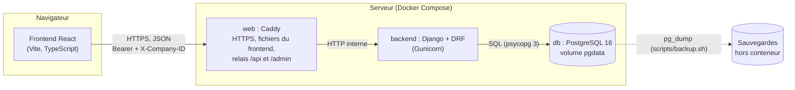
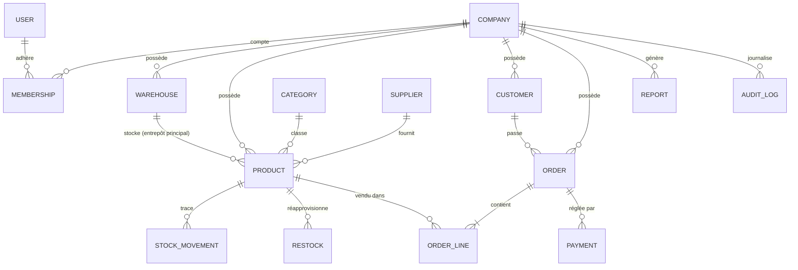

# Architecture de WANS TECH

Ce document approfondit les sections « Architecture » et « SaaS multi-entreprise » du [README](../README.md).

## 1. Vue d'ensemble

Une seule instance applicative sert **toutes** les entreprises clientes. Le nombre de conteneurs dépend des services (3), pas du nombre de PME.

## 2. Monolithe modulaire

Le backend est une application Django découpée en applications par domaine métier (`backend/apps/`). Elles partagent un processus et une base, mais chacune possède ses modèles, ses règles et ses routes.

| Application | Responsabilité | Dépend de (modèles) |
|---|---|---|
| `core` | Modèle de base `TenantModel`, montants (`MoneyField`, `to_money`), format d'erreur, pagination, santé | — |
| `accounts` | Utilisateur (connexion par e-mail), JWT, cookie de rafraîchissement, profil, mot de passe | `companies` (inscription) |
| `companies` | Entreprises, adhésions, rôles et capacités, **isolation** (`tenancy.py`), numérotation par entreprise | `core`, `accounts` |
| `audit` | Journal des opérations sensibles | `companies` |
| `warehouses` | Entrepôts | `core`, `companies` |
| `catalog` | Catégories, fournisseurs, produits | `warehouses` |
| `inventory` | Mouvements de stock, réapprovisionnements, alertes, notifications | `catalog`, `warehouses` |
| `customers` | Clients | `core` |
| `sales` | Commandes et lignes ; confirmation, statuts, annulation | `customers`, `catalog`, `warehouses`, `inventory` |
| `payments` | Encaissements rapprochés des commandes | `sales`, `customers` |
| `reports` | Tableau de bord, statistiques, analyses, rapports, recherche | lecture de tous les domaines |

Les dépendances entre **modèles** forment un graphe sans cycle. Deux orchestrations appellent un domaine voisin par import local dans la fonction, de façon explicite et commentée :

- `catalog.services.create_product` enregistre le stock initial via `inventory.services.apply_movement` ;
- `sales.services.create_order` (mode `transaction`) enregistre le paiement via `payments.services.record_payment`.

Les domaines lisent les ventes au travers de `sales/selectors.py` (unités vendues, totaux par client, reste à payer) plutôt qu'en interrogeant directement les tables d'un autre domaine.

Aucune application n'a été créée sans besoin réel : il n'existe ni `expenses`, ni `purchases`, ni `notifications` séparés, car le frontend n'a pas d'écran de dépenses, les réapprovisionnements couvrent les achats présents, et les notifications sont dérivées des alertes de stock.

## 3. Principes DDD et hexagonaux réellement appliqués

Appliqués :

- **Contextes délimités** : une application par domaine, avec son vocabulaire (commande, mouvement, réapprovisionnement…).
- **Règles métier hors des vues** : les vues HTTP (`views.py`) valident l'entrée (`serializers.py`) puis délèguent aux **services** (`services.py`), qui portent les invariants (stock jamais négatif, totaux recalculés, transitions de statut, reste à payer).
- **Séparation commande / requête** : les écritures passent par les services ; les lectures agrégées par des **sélecteurs** (`selectors.py`).
- **Adaptateurs entrants** : DRF (vues, serializers, routes) traduit HTTP ↔ domaine ; le format camelCase du frontend n'apparaît que dans les serializers.
- **Invariants doublés en base** : contraintes `CHECK` et `UNIQUE` PostgreSQL (stock ≥ 0, total = sous-total − remise, unicités par entreprise).

Volontairement non appliqués (pragmatisme) :

- Pas de couche « repository » ni de ports abstraits devant l'ORM : l'ORM Django est l'adaptateur de persistance, utilisé directement par les services. Ajouter des interfaces n'apporterait rien tant qu'il n'existe qu'un seul stockage.
- Les entités sont des modèles Django (pas d'objets du domaine séparés).

## 4. Parcours d'une requête

Exemple : « Confirmer la vente » depuis `OrderForm`.

1. `OrderForm` appelle `ordersService.create(input, 'vente', idempotencyKey)` (`frontend/src/services/index.ts`).
2. En mode API, `apiAdapters.orders.create` envoie `POST /api/v1/orders/` via `frontend/src/services/http.ts`, avec `Authorization: Bearer <jeton>`, `X-Company-ID: <uuid>` et `credentials: 'include'`.
3. En production, Caddy reçoit la requête HTTPS et la relaie à Gunicorn.
4. DRF authentifie le jeton (`JWTAuthentication`), puis la permission `CompanyAccess` retrouve l'adhésion (utilisateur, entreprise), vérifie qu'elle est active et que le rôle a la capacité `sell`.
5. `OrderCreateSerializer` valide les champs ; `sales.services.create_order`, dans une transaction :
   - résout client, entrepôt et produits **dans l'entreprise active uniquement** ;
   - vérifie le droit de modifier les prix ;
   - recalcule sous-total, remise et total en `Decimal` ;
   - attribue le numéro `CMD-xxxxx` sous verrou du compteur de l'entreprise ;
   - verrouille les produits (`SELECT … FOR UPDATE`, ordre déterministe) et crée les mouvements de stock ;
   - échoue entièrement (rollback) si un stock est insuffisant.
6. La vue journalise l'opération (`audit`) et renvoie la commande au format `Order` du frontend.
7. Le frontend affiche le toast, puis `subscribeToData` recharge silencieusement les listes ouvertes.

## 5. Multi-entreprise

### Modèle

- `Company` : entreprise cliente (UUID), profil, `is_active`.
- `Membership` : lien utilisateur ↔ entreprise, `role` (`owner`, `admin`, `manager`, `seller`, `viewer`) et `status` (`active`, `suspended`). Unicité (utilisateur, entreprise) ; un seul propriétaire par entreprise (index unique partiel).
- Toute donnée métier hérite de `TenantModel` (clé étrangère `company`, `PROTECT`). Les lignes de commande portent aussi `company`, pour des index et filtres directs.
- Les codes publics (`CMD-00001`, `CLI-0001`, `ENT-001`…) sont **uniques par entreprise** (`UniqueConstraint(company, code)`) et produits par `CodeSequence`, verrouillé ligne par ligne.

### Contrôles

| Niveau | Mécanisme |
|---|---|
| Requête | `CompanyAccess` : en-tête `X-Company-ID` → adhésion active + entreprise active + capacité du rôle, à **chaque** requête (une suspension prend effet immédiatement, même avec un jeton encore valide). |
| QuerySets | `CompanyScopedViewSet.get_queryset()` filtre toujours par `request.company` ; un objet d'une autre entreprise donne 404. |
| Références entrantes | `get_in_company()` résout chaque identifiant reçu (SKU, client, entrepôt, commande) dans l'entreprise active ; une référence étrangère est traitée comme inexistante. |
| Écriture | L'entreprise est affectée par le serveur (`serializer.save(company=request.company)`) ; aucun serializer n'expose `company` en écriture. |
| Agrégats | Tableau de bord, statistiques, rapports, recherche, notifications et alertes prennent tous `company` en paramètre explicite. |
| Base | Contraintes d'unicité par entreprise ; clés étrangères `PROTECT`. |

Tests : `backend/tests/test_isolation.py` (voir [TESTING.md](TESTING.md)).

### Row-Level Security PostgreSQL : évaluée, non activée

La RLS ajouterait une seconde barrière en base. Elle n'est **pas** activée en première version :

- elle exige de positionner une variable de session (`SET app.company_id`) au début de chaque transaction, en coordination avec la persistance des connexions (`CONN_MAX_AGE`) et un futur pooler (PgBouncer en mode transaction réinitialise ces variables) ;
- les migrations, l'administration Django, les scripts de sauvegarde et les tests doivent utiliser un rôle qui contourne ou configure la politique ;
- les agrégations transverses légitimes (supervision WANS TECH) demandent un rôle distinct.

Ces points sont réalisables, mais exigent une configuration et des tests dédiés qu'il serait imprudent d'introduire à moitié. La recommandation est de l'ajouter dans une version ultérieure, avec un rôle applicatif non propriétaire des tables et des tests qui tentent des lectures croisées en SQL brut.

## 6. Modèle de données

Règles importantes :

- **Montants** : `NUMERIC(14,2)` en francs congolais ; calculs en `Decimal`, arrondi au centime demi supérieur. Jamais de `float` côté serveur. L'API les renvoie en nombres JSON (le frontend attend des `number`).
- **Stock** : porté par le produit (entrepôt principal), modifié uniquement par `apply_movement`, qui écrit un `StockMovement` (type, quantité signée, solde après, référence, auteur). `CHECK stock >= 0`.
- **Commandes** : statuts `Brouillon`, `En attente`, `En traitement`, `Expédiée`, `Livrée`, `Annulée`. Jamais supprimées ; l'annulation restitue le stock. `CHECK total = subtotal - discount_amount`. Coût d'achat figé par ligne pour la marge.
- **Paiements** : non modifiables ni supprimables par l'API ; référence unique par entreprise sans tenir compte de la casse ; seul le statut `Réglé` réduit le reste à payer.
- **Dates** : `DateField` pour les dates métier ; horodatages en UTC, affichés et calculés dans le fuseau `Africa/Kinshasa`.

## 7. Évolution de l'architecture

1. **Aujourd'hui** : monolithe modulaire, une base partagée, trois conteneurs.
2. **Mesurer** : temps de réponse par endpoint (journaux Gunicorn), erreurs, charge CPU/mémoire, taille et croissance de la base, requêtes lentes (`pg_stat_statements`).
3. **Monter en ressources** : plus de CPU/mémoire, plus de workers Gunicorn, puis plusieurs réplicas du conteneur `backend` derrière Caddy (l'application est sans état : sessions en JWT, compteurs en base). Le cache de limitation de débit devra alors devenir partagé (Redis).
4. **Ajouter selon un besoin mesuré** : cache (Redis) pour les agrégats du tableau de bord ; file de tâches (Celery/RQ) pour les rapports lourds, les e-mails d'invitation ou un futur moteur de prévision ; réplique PostgreSQL en lecture pour les rapports.
5. **Extraire un domaine** seulement si son rythme de charge ou d'évolution diverge nettement (candidat naturel : `reports`/prévisions, en lecture seule). Les frontières actuelles (sélecteurs, services, contrat d'API) permettent de le faire sans réécrire le produit.

Aucune capacité (nombre d'entreprises par serveur) n'est garantie sans test de charge.

### Quand une base séparée par client devient pertinente

- exigence contractuelle ou réglementaire d'isolement physique ou de localisation des données ;
- client dont le volume ou la charge pénalise les autres ;
- besoin de restaurer un seul client à un instant précis sans toucher aux autres ;
- personnalisations de schéma propres à un client.

Le code y est préparé en partie : toutes les requêtes passent par l'entreprise active. Il faudrait ajouter un routage de base (`DATABASE_ROUTERS`) selon l'entreprise et un outillage de migration multi-bases.
